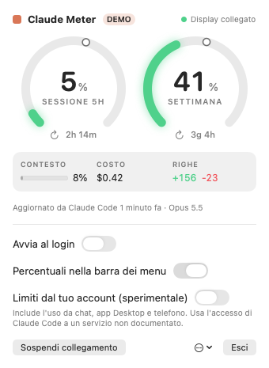

# claude-meter

*A desk display for your Claude plan limits (5-hour session and weekly), on a ~€15 ESP32 board,
with a signed macOS menu bar app. Documentation in Italian.*

Un piccolo display da scrivania che mostra a colpo d'occhio quanto hai usato dei **limiti del tuo
abbonamento Claude** (Pro, Max o Ultra), più un'app per la barra dei menu del Mac che lo alimenta.

<picture>
  <source media="(prefers-color-scheme: dark)" srcset="docs/images/pannello-dark.png">
  
</picture>

## Cosa mostra

- **Sessione 5h** e **Settimana**: due archi con la percentuale usata e il conto alla rovescia al reset.
- **Ritmo**: un pallino bianco sull'arco indica dove saresti se distribuissi l'uso in modo uniforme.
  Se l'arco lo supera, stai consumando più in fretta del previsto.
- **Pagina Dettaglio** (tocca lo schermo): ora esatta del reset, scarto rispetto al ritmo e proiezione,
  per esempio "100% alle 15:40" oppure "~78% al reset".
- **Sessione di Claude Code**: modello, contesto usato, costo, righe aggiunte e tolte.
- **LED** sulla scheda: spento sotto il 75%, ambra fino al 90%, rosso che "respira" oltre.
  Un **tocco lungo** lo silenzia finché la situazione non peggiora.
- Nell'header, un pallino indica lo stato: grigio se il Mac è scollegato, verde se è collegato,
  arancione se Claude Code sta lavorando.

## Cosa serve

| | |
|---|---|
| Abbonamento | Claude **Pro, Max o Ultra** (con una chiave API i limiti non esistono) |
| Software | **Claude Code** installato e collegato al tuo account, macOS 14 o successivo |
| Scheda | **ESP32-2432S028R**, detta "Cheap Yellow Display": ESP32 con LCD 2,8" 320×240 e touch, circa 15 € |
| Cavo | USB **dati** (non solo ricarica), di solito micro-USB verso USB-C |

Il chip USB della scheda (CH340) è supportato da macOS senza installare driver.

## Installazione

**1. App per il Mac.** Scarica `ClaudeMeter-<versione>.dmg` dalla pagina
[Releases](https://github.com/mavrizio/claude-meter/releases). L'app è firmata e notarizzata da Apple.
Trascinala in Applicazioni e aprila. Nel pannello premi **Configura**: l'app aggiunge la propria barra
di stato a Claude Code, dopo aver fatto un backup di `~/.claude/settings.json`. Poi attiva
**Avvia al login**.

**2. Firmware sulla scheda.** Per ora serve [PlatformIO](https://platformio.org/install/cli):

```bash
cd firmware
pio run -t upload
```

Prima di caricare il firmware, chiudi l'app o premi "Sospendi collegamento", perché l'app tiene occupata
la porta USB. In futuro sarà l'app stessa ad aggiornare il display (vedi la [roadmap](docs/roadmap.md)).

**3. Uso.** Collega il display, apri Claude Code e invia un messaggio: gli archi si riempiono dopo la prima
risposta. L'icona nella barra dei menu mostra le stesse percentuali.

> Sui MacBook con la tacca, se le icone nella barra dei menu sono tante, quelle in più finiscono nascoste
> dietro la tacca. Riaprendo l'app da Spotlight compare comunque il pannello.

## Da dove arrivano i dati

```
Claude Code ── statusLine ──► helper ──► ~/.claude-meter/state.json ──► app ── USB ──► display
```

- **Fonte ufficiale (predefinita).** Claude Code passa i limiti d'uso al comando della
  [barra di stato](https://code.claude.com/docs/en/statusline) a ogni risposta. È documentata e non usa
  credenziali né Internet. Il limite: i valori si aggiornano **solo quando Claude Code risponde**. L'uso dalla
  chat (claude.ai, app Desktop, telefono) compare solo alla risposta successiva. Inoltre, a quanto
  abbiamo visto, il pannello grafico di Claude Code in VS Code non esegue la barra di stato: con
  l'impostazione `claudeCode.useTerminal` Claude Code gira nel terminale integrato e funziona.
- **"Limiti dal tuo account" (sperimentale, spenta di default).** Se la attivi nel pannello, l'app chiede
  ogni pochi minuti le percentuali allo stesso servizio Anthropic usato dal comando `/usage` di Claude Code,
  con l'accesso di Claude Code salvato nel portachiavi. I numeri sono quelli del tuo account e includono
  chat, app e telefono. Il token non viene mai copiato, salvato, rinnovato o inviato altrove. Attenzione:
  il servizio **non è documentato** e può cambiare senza preavviso, e un uso automatico potrebbe non essere
  in linea con i termini d'uso degli abbonamenti consumer. Valuta tu se attivarla.

## Sviluppo

```
firmware/   PlatformIO + LVGL 9.3 per ESP32-2432S028R (Arduino core)
macos/      app Swift/SwiftUI per la barra dei menu, helper statusLine, test, script di release
host/       versione Python originale (statusline.py + meterd.py), utile per sviluppo e demo
docs/       storia delle decisioni e roadmap
```

```bash
cd macos && swift build && swift test           # libreria MeterCore e test
macos/scripts/build-app.sh                      # build/Claude Meter.app (firma ad-hoc)
macos/scripts/release.sh                        # DMG universale firmato e notarizzato (serve un Developer ID)
cd firmware && pio run                          # compila il firmware
host/.venv/bin/python host/meterd.py --demo     # dati finti animati sul display, senza Claude
```

Il protocollo seriale (JSON su righe, 115200 baud), i pin della scheda e le insidie già incontrate sono in
[CLAUDE.md](CLAUDE.md), che fa da documentazione tecnica completa.

## Licenza

[MIT](LICENSE). Progetto indipendente, **non affiliato ad Anthropic**. Ispirato a
[Blink](https://github.com/KfirLevy258/Blink), ma riscritto da zero.
